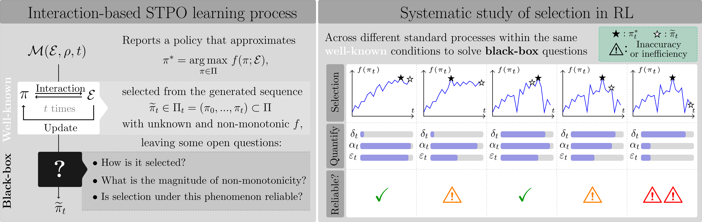
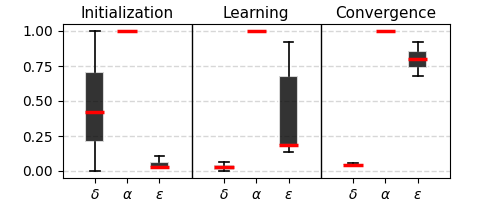
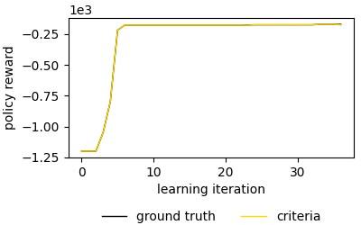
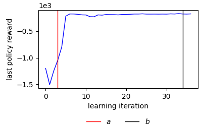
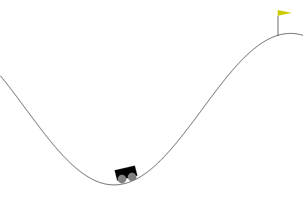
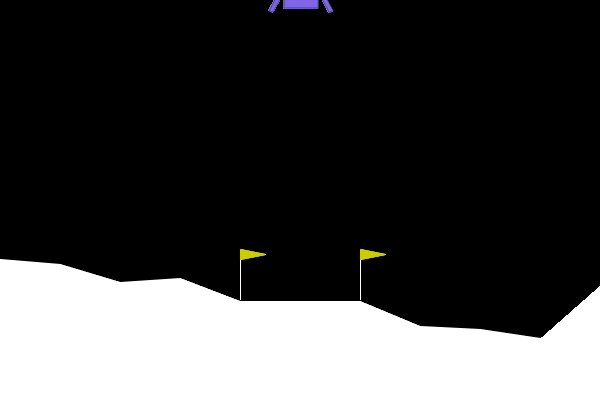
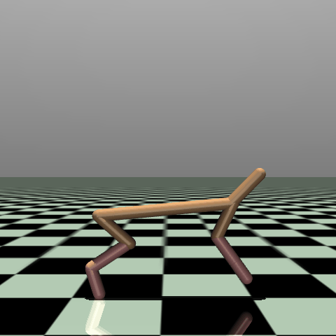
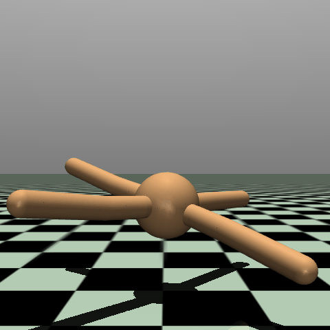
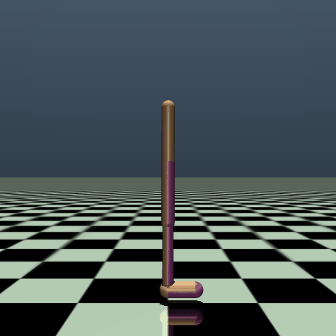

# BPT-RL - Best Policy Tracking in Reinforcement Learning

Judith Echevarrieta, Etor Arza, Aritz Pérez, Josu Ceberio

## Repository overview

This repository accompanies the paper *Best Policy Tracking in Reinforcement Learning* and includes its supplementary material. The work focuses on policy selection in single-task policy-based Reinforcement Learning (RL). Although it is well-known that learning in this setting produces sequences of policies with non-monotonic and generally unknown performance, comparatively little attention is paid to how the policy ultimately reported as learned is selected. This raises the open question of how reliable common policy-selection practices are under these conditions.



*Figure. The left panel summarizes an interaction-based Single-Task Policy Optimization (STPO) process and the open questions obscured by black-box policy selection in common RL practice. The right panel illustrates the systematic study of selection criteria using measures of performance degradation ($\delta$), selection accuracy ($\alpha$), and selection efficiency ($\varepsilon$) across different learning scenarios.*

### How is the learned policy selected in common RL practice?

In common experimental practice with widely used open-source RL libraries, policy selection is treated as a black box. A method $\mathcal{M}$ is run in an environment $\mathcal{E}$ with a random seed $\rho$ for a fixed training budget $t$. This produces a sequence of visited policies $\Pi_t$, from which the selected policy $\widetilde{\pi}_t$ is returned as the learned outcome, while the criterion used to select it may remain implicit. This motivates two questions: how is the returned policy selected from the sequence, and can criteria used in practice capture the best performance achieved during learning while justifying the computational time invested?

### What this work contributes

The paper makes policy selection explicit by formalizing three simple criteria identified in common RL libraries—*last*, *train*, and *validation*—within a unified framework. It also introduces post-hoc diagnostic metrics for performance degradation ($\delta_t$), selection accuracy ($\alpha_t$), and selection efficiency ($\varepsilon_t$). These metrics support a systematic empirical assessment of the criteria across representative actor-critic continuous-control settings with varied learning dynamics.

### What the results show

The results show that common selection criteria can return a policy that performs below the best policy visited during learning. This can understate the performance attained within the computational time already invested and distort conclusions drawn from an RL experiment. The findings call for greater attention to policy selection as part of RL evaluation and for more explicit, carefully designed selection procedures.

### What this repository contains

- `reproducibility/` contains scripts and data-processing code for reproducing the paper's experiments, analyses, and figures.
- `library/` provides a separate BPT-RL tool for running supported Stable-Baselines3 methods and environments with configurations based on RL Baselines3 Zoo, explicitly choosing the policy-selection criterion, and analyzing learning processes. It can also serve as a basis for extending these procedures.

## Reproducibilidad

Para esto tengo que crear una carpeta que contenga exclusivamente el material necesario para construir las figuras que hemos mostrado en el paper. Ahora mismo esa carpeta es: `reproducibility`

### Step 0: dependencias

Que paquetes se deben instalar antes de nada. Para esto rellenare el: `requirements.txt`, y tengo que decir como ejecutarlo. Este debera contener todas las librerias que uso y las versiones correctas, y las dependencias entre paquetes:

- SB3
- Gymnasium
- ...

NOTA: quiza es preferible que clone la libreria stable-baselines3, en lugar de mandar a los usuarios que la instalen, y dejarla yo dentro de mi libreria como una carpeta mas. Porque ahora mismo yo modifico funciones de la libreria que tengo instalada en mi pc, si con el tiempo se modifica algo, puede que ya mi codigo no funcione. En cambio, si lo clono, seguiria funcionando.

### Step 1: Almacenamiento de datos de aprendizaje y validacion por iteracion durante la ejecucion de procesos para la simulacion

Para generar los mismos datos usados en el analisis para un entorno. Aqui mostramos el ejemplo para el entorno Pendulum.
Siguiendo estos pasos se pueden almacenar los mismo datos que hemos almacenado nosotros para simular la aplicacion de los diferentes criterios de seleccion por cada proceso determinado por PPO-entorno-semilla.
Para cada entorno, nosotros ejecutamos individualmente las 30 semillas consideradas. Por eso el codigo que mostramos permite guardar los mismos datos guardados nosotros al ejecutar cada semilla.

ejemplo de ejecucion en: `final/generate_process_data.py `. Estaria bien poner en ese script un `if __main__:`y poner en una linea como ejecutarlo en la terminal introduciendo los argumentos con -- como suelen hacer comunmente las librerias. Algo como: 

```
generate_process_data.py --env='Pendulum' --seed=1 --path='final/results/data/SB3_PPO_Pendulum' --available_CPUs=6
```

Luego explicar que esto dara un mensaje de output cuando los CPUs disponibles no son suficientes para generar los datos de la misma manera, y que de lo contrario, se usaran exactamente los necesario para la interaccion de aprendizaje, mientras que se aprovecharan los disponibles totales indicados para el ground truth, para aligerar el proceso.

Para obtener todos los datos almacenados para nuestra experimentacion, se debera repetir el proceso para los 7 entornos, con 30 semillas. Por cada ejecucion se generan dos bases de datos, que no hemos subido a GitHub por su tamaño. Sin embargo, se generan de la manera que indicamos, y gracias a proporcionar los csv del Step 2, se dejan disponibles los datos necesarios para generar las graficas.

### Step 2: Generar datos necesarios para el analisis a partir de los datos almacenados

Por cada entorno, ahora tendremos datos almacenados por semilla. Lo que haremos es, primero extrater por semilla de los datos almacenados los datos necesarios para el analisis (degradacion, regiones, estimaciones, ground truth, precisiones, eficiencias), y despues uniremos los datos asociados a diferentes semillas de mismas medidas en una sola base de datos. 

Como resultado se nos generaran unos csv dentro de una carpeta llamada `analysis_data` en el path indicado, que son los csv que se usan para llevar a cabo el analisis completo del paper, y la construccion de todas las figuras. Estos csv si estan guardados en GitHub, dento de las carpetas `all_data.zip`, aunque algunas aun no he subido porque aun en zip ocupan mucho y no me deja hacer commit.

```
generate_analysis_data.py --seeds=list(range(1,5)) --env='Pendulum' --path='final/results/data'
```

Nosotros dejamos estos datos ya en formato .zip por cada entorno considerado en el analisis. Por lo que, se pueden descomprimir directamente para diponer de los datos, o generarlos siguiendo el proceso descrito. A partir de estos datos, se generan unos datos comunes, las configuraciones comunes:

```
common_data.py
```

### Step 3: Generar graficas del analisis a partir de los datos generados para ello

Explicar que hay tres tipos de figuras, las auxiliares del cuerpo del paper, las del analisis principal, y las de los apendices. El codigo que se debe ejecutar para conseguirlas es:

```
generate_graphs.py --data_path='final/results/data' --figure_path='final/results/figures'
```

que genera las figuras en tres subcarpetas dentro del directorio indicado.

### Graficas auxiliares y tablas del paper

Los datos sinteticos de las graficas auxiliares estan en: `final/results/data/paper/synthetic`
Para generar las figuras auxiliares a partir de ellos: 

```
paper_figures.py 
```

Para generar los datos de las tablas de complejidades-degradacion y apendice de regiones:

```
paper_data.py 
```

## BPT-RL library

El script principal de esta libreria es por ahora: `library/bpt-rl.py`. 

Con lo que esta por ahora:

```python
from bpt-rl import *

# Ejecutar proceso con criterio seleccionado y generar datos
PackOptions.PPO_Pendulum(1,'library/results',{ "name": 'cost_driven_validation',"kappa": 5,"phi": None,"phi_c": 0.2 },available_resources=6)

# Obtener analisis diagnostico del proceso
analyzer=ProcessAnalysis('library/results/SB3_PPO_Pendulum/seed1/df_process_cost_driven_validation_5_0.2.csv','library/results/SB3_PPO_Pendulum/seed1')
analyzer.learning_curve()
analyzer.process_regions()
analyzer.criterion_diagnosis()
```

Que genera la base de datos `library/results/SB3_PPO_Pendulum/seed1/df_process_cost_driven_validation_5_0.2.csv`, a partir de la cual se pueden construir estas figuras: 

<table width="80%" align="center">
  <tr>
    <td align="center">
      
    </td>
    <td align="center">
      
    </td>
    <td align="center">
      
    </td>
  </tr>
  <tr>
    <td align="center">Diagnostic</td>
    <td align="center">Learning curves</td>
    <td align="center">Regions</td>
  </tr>
</table>

Los settings que incluimos en esta "libreria":

<table width="80%" align="center">
  <tr>
    <th>Engine</th>
    <th>Environment</th>
    <th>PPO</th>
    <th>SAC</th>
  </tr>

<tr>
    <td>Classic Control</td>
    <td>
      <table>
        <tr>
          <td align="center">
            Pendulum<br>
            
          </td>
          <td align="center">
            MountainCarContinuous<br>
            
          </td>
        </tr>
      </table>
    </td>
    <td align="center" style="font-size: 20px;">&#10003;</td>
    <td align="center" style="font-size: 20px;">&#10003;</td>
  </tr>

<tr>
    <td>Box2D</td>
    <td>
      <table>
        <tr>
          <td align="center">
            LunarLanderContinuous<br>
            
          </td>
          <td align="center">
            BipedalWalker<br>
            
          </td>
        </tr>
      </table>
    </td>
    <td align="center" style="font-size: 20px;">&#10003;</td>
    <td align="center" style="font-size: 20px;">&#10003;</td>
  </tr>

<tr>
    <td>MuJoCo</td>
    <td>
      <table>
        <tr>
          <td align="center">
            Swimmer<br>
            
          </td>
          <td align="center">
            Hopper<br>
            
          </td>
          <td align="center">
            HalfCheetah<br>
            
          </td>
          <td align="center">
            Ant<br>
            
          </td>
          <td align="center">
            Walker2d<br>
            
          </td>
        </tr>
      </table>
    </td>
    <td align="center" style="font-size: 20px;">&#10003;</td>
    <td align="center" style="font-size: 20px;">&#10007;</td>
  </tr>

</table>

# Pendientes

- [ ] Traducir a ingles los comentarios de ciertos scripts
- [ ] Corregir en la definicion de `accuracy` del script `bpt-rl.py`, considerando el tiempo extra del criterios de validacion
- [ ] Añadir en el script pertinente de la carpeta `reproducibility` la generacion de la tabla añadida en el apendice B.1 tras la revision
- [ ] En `bpt-rl.py` quedan algunas funciones con TODOs por si en un futuro decido incorporar criterios de seleccion mejorados a esta "libreria", e.g., una criterio de validacion mejorado con el checkpointing TD7 o un criterio train mejorado con estimaciones OPE (quiza esto lo necesite para esta revision en TMLR, porque todavia no hemos terminado)
- [ ] Escribir bien el README
- [ ] Hacer publico el repositorio en GitHub (ahora esta privado), y privatizar el que esta publico ahora porque ya ha quedado obsoleto (contiene todo lo hecho en los dos años anteriores hasta llegar al articulo final)
