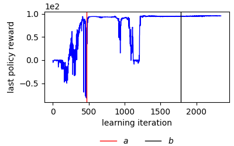
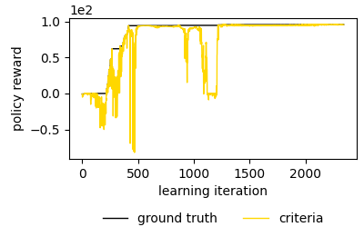
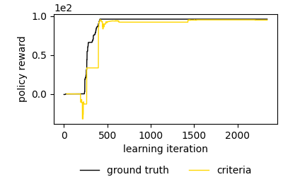
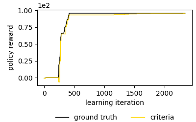
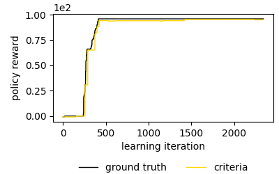
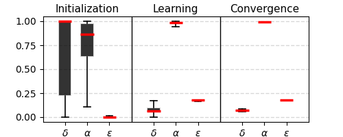
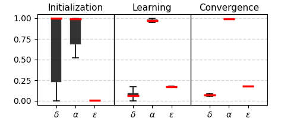
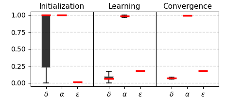
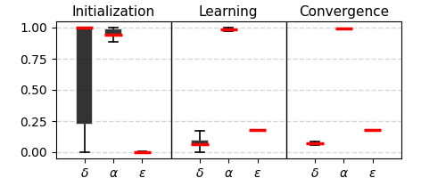

# BPT-RL - Best Policy Tracking in Reinforcement Learning

Judith Echevarrieta, Etor Arza, Aritz Pérez, Josu Ceberio

## Repository overview

This repository accompanies the paper *Best Policy Tracking in Reinforcement Learning* and includes its supplementary material. The work focuses on policy selection in single-task policy-based Reinforcement Learning (RL). Although it is well-known that learning in this setting produces sequences of policies with non-monotonic and generally unknown performance, comparatively little attention is paid to how the policy ultimately reported as learned is selected. This raises the open question of how reliable common policy-selection practices are under these conditions.


*Figure. The left panel summarizes an interaction-based Single-Task Policy Optimization (STPO) process and the open questions obscured by black-box policy selection in common RL practice. The right panel illustrates the systematic study of selection criteria using measures of performance degradation ($\delta$), selection accuracy ($\alpha$), and selection efficiency ($\varepsilon$) across different learning scenarios.*

### How is the learned policy selected in common RL practice?

In common experimental practice with widely used open-source RL libraries, policy selection is treated as a black box. A method $\mathcal{M}$ is run in an environment $\mathcal{E}$ with a random seed $\rho$ for a fixed training budget $t$. This produces a sequence of visited policies $\Pi_t$, from which the selected policy $\widetilde{\pi}_t$ is returned as the learned outcome. The selection criterion is often left implicit, embedded in an implementation-level heuristic rather than stated explicitly. This raises two questions: how is the returned policy selected from the sequence, and can criteria used in practice capture the best performance achieved during learning $f(\pi_t^*)$ while justifying the computational time invested?

### What contributes this work?

The paper makes policy selection explicit by formalizing three simple criteria identified in common RL libraries—*last*, *train*, and *validation*—within a unified framework. It also introduces post-hoc diagnostic metrics for performance degradation ($\delta_t$), selection accuracy ($\alpha_t$), and selection efficiency ($\varepsilon_t$). These metrics support a systematic empirical assessment of the criteria across representative actor-critic continuous-control settings exhibiting diverse non-monotonic learning dynamics.

### What show the results?

The results show that common selection criteria can return a policy that performs below the best policy visited during learning. This can understate the performance attained within the computational time already invested and distort conclusions drawn from an RL experiment. The findings call for greater attention to policy selection as part of RL evaluation and for more explicit, carefully designed selection procedures.

### What contains this repository?

- `reproducibility/` contains scripts and data-processing code for reproducing the paper's experiments, analyses, and figures.
- `library/` provides a separate BPT-RL tool for running supported Stable-Baselines3 methods and environments with configurations based on RL Baselines3 Zoo, explicitly choosing the policy-selection criterion, and analyzing learning processes. It can also serve as a basis for extending these procedures.

## Reproducibility

The paper's empirical analysis examines a representative setting using Proximal Policy Optimization (PPO) and seven standard continuous-control benchmark environments: two based on Box2D and five based on MuJoCo. Each method–environment combination is evaluated across 30 random seeds. The steps below describe how to generate the learning-process data, derive the analysis data, and reproduce the figures.

### Step 0: Install dependencies

The experiments were run on Ubuntu 22.04.5 LTS with Python 3.10.12 using Conda. The following instructions assume that Conda is installed and that you are using a Bash-compatible terminal on Linux. The pinned package versions used for this setup are listed in `requirements.txt`. From the repository root, create and activate the environment, then install the dependencies:

```bash
source ~/miniconda3/etc/profile.d/conda.sh

conda create --prefix ./env_bpt_rl python=3.10.12 -y
conda activate ./env_bpt_rl

python -m pip install -r requirements.txt
```

If Conda is installed elsewhere, adjust the path to `conda.sh`. On other systems, some dependencies may require platform-specific changes. Once the environment is activated and the dependencies are installed, you can run the project scripts from the repository root.

### Step 1: Store learning-process data

The empirical analysis covers 210 learning processes: PPO across seven benchmark environments and 30 random seeds per environment. Each process is run once, and its training and evaluation interactions are stored. The next step uses these records to simulate different policy-selection criteria and configurations on the same policy sequence, without rerunning training for every criterion.

Run the generator once for each environment–seed pair. Pendulum is included as a simple example, although it is not one of the seven environments in the paper:

```bash
python -m reproducibility.generate_process_data \
  --env Pendulum \
  --seed 1 \
  --path reproducibility/results/data/SB3_PPO_Pendulum \
  --available_CPUs 6
```

The resource check reports whether the available CPU count meets the environment's configured requirement. The learning process uses its configured number of workers; the supplied CPU count is also used to parallelize ground-truth evaluation. To reproduce the paper's full set of processes, run the command for each of the seven environments—LunarLanderContinuous, BipedalWalker, Swimmer, HalfCheetah, Hopper, Ant, and Walker2d—and seeds 1 through 30.

For each environment–seed pair, the script stores `df_traj.csv` and `df_val.csv` under `SB3_PPO_<environment>/pack_PPO_<environment>_seed<seed>_/process_info/`. These files contain per-policy training-interaction data and evaluation data, respectively. The raw process files for the paper's experiments are large and are not all included in the repository; the smaller Pendulum example is provided. The analysis-data archives described in Step 2 provide the derived data used to create the figures.

### Step 2: Generate analysis data

This step reads the stored process data, calculates per-seed measures for the selection criteria and their configurations, then joins the results across seeds into CSV files under `SB3_PPO_<environment>/analysis_data/`. Pendulum is used below as a compact example; the same command can be applied to any supported environment for which process data are available.

```bash
python -m reproducibility.generate_analysis_data \
  --seeds 'list(range(1, 5))' \
  --env Pendulum \
  --path reproducibility/results/data
```

For the paper analysis, use seeds 1 through 30 and each of the seven benchmark environments. The resulting files include:

| Files                                                                                            | Contents                                                                                                                                                                                                                                                                   |
| ------------------------------------------------------------------------------------------------ | -------------------------------------------------------------------------------------------------------------------------------------------------------------------------------------------------------------------------------------------------------------------------- |
| `learning_regions.csv`, `deg_evolution.csv`                                                      | Learning-region boundaries and degradation over the policy sequence.                                                                                                                                                                                                       |
| `df_best_truth.csv`, `df_last_truth.csv`, `df_train_truth.csv`, `df_test_truth.csv`              | Ground-truth rewards for the best policy and policies selected by the criteria; `test` denotes validation-based selection.                                                                                                                                                 |
| `df_last_prec.csv`, `df_train_prec.csv`, `df_test_prec.csv`                                      | Selection accuracy over the sequence for the criterion configurations.                                                                                                                                                                                                     |
| `df_last_eff.csv`, `df_train_eff.csv`, `df_test_eff.csv`                                         | Selection efficiency over the sequence for the criterion configurations selected for the final analysis. Unlike accuracy, which is evaluated across a grid of possible configurations during sensitivity analysis, efficiency is reported for the selected configurations. |
| `df_last_est.csv`, `df_train_est.csv`, `df_test_est.csv`, `df_test_cost.csv`, `df_test_n_ep.csv` | Training and validation estimates and the associated validation costs and episode counts.                                                                                                                                                                                  |
| `df_train_all_seq_est.csv`, `df_test_all_seq_est.csv`, `df_test_all_seq_cost_len.csv`            | Estimates and validation episode-cost details across the full policy sequences.                                                                                                                                                                                            |

The repository provides an `all_data.zip` archive for each of the seven paper environments under `reproducibility/results/data/SB3_PPO_<environment>/`. These archives contain the derived analysis data used to generate the figures. If process data are available, the analysis CSVs can instead be regenerated with the command above.

Once analysis data are available for all seven paper environments, run the common-data script from the repository root with the project environment activated. It extracts any available archives and calculates shared criterion configurations. The script takes no additional arguments:

```bash
python -m reproducibility.src.common_data
```

### Step 3: Generate the analysis figures

The analysis produces three groups of figures: auxiliary illustrations of the diagnostic metrics and learning regions (Figures 2–5; see [Auxiliary figures and paper tables](#auxiliary-figures-and-paper-tables)), main-analysis figures that summarize degradation and compare the selection criteria, and appendix figures covering estimator behavior, validation configurations and costs, learning regions, and resource allocation. The main-analysis and appendix figures are saved in `analysis/` and `appendix/`, respectively, under the selected figure directory.

From the repository root, generate the main-analysis and appendix figures with:

```bash
python -m reproducibility.generate_graphs \
  --data_path reproducibility/results/data \
  --figure_path reproducibility/results/figures
```

<details>
<summary>Main-analysis outputs and their corresponding paper figures</summary>

| Repository output                                        | Paper figure |
| -------------------------------------------------------- | ------------ |
| `analysis/degradation_precision_efficiency.pdf`          | Figure 6     |
| `analysis/patterns_degradation_precision_efficiency.pdf` | Figure 7     |
| `analysis/criteria_comparison_how_times_best.pdf`        | Figure 8     |
| `analysis/criteria_comparison_in_which_deg_best.pdf`     | Figure 9     |

</details>

<details>
<summary>Appendix outputs and their corresponding paper figures</summary>

| Repository output                                          | Paper figure |
| ---------------------------------------------------------- | ------------ |
| `appendix/estimations_only_test.pdf`                       | Figure 10    |
| `appendix/estimations.pdf`                                 | Figure 11    |
| `appendix/estimations_curves.pdf`                          | Figure 12    |
| `appendix/configurations.pdf`                              | Figure 13    |
| `appendix/val_cost_throughout_sequence.pdf`                | Figure 14    |
| `appendix/cost_of_cost_driven_test_boxplots_pack_freq.pdf` | Figure 15    |
| `appendix/cost_of_cost_driven_test_boxplots.pdf`           | Figure 16    |
| `appendix/cost_of_cost_driven_test_boxplots_pack_cost.pdf` | Figure 16    |
| `appendix/cost_of_cost_driven_test.pdf`                    | Figure 17    |
| `appendix/test_default_vs_with_cost.pdf`                   | Figure 18    |
| `appendix/val_freq_throughout_sequence.pdf`                | Figure 19    |
| `appendix/regions.pdf`                                     | Figure 20    |
| `appendix/criteria_consequences_early_stopping_all.pdf`    | Figure 21    |
| `appendix/criteria_consequences_early_stopping_eff.pdf`    | Figure 22    |
| `appendix/criteria_consequences_early_stopping_prec.pdf`   | Figure 23    |
| `appendix/early_stopping_tradeoff.png`                     | Figure 24    |

</details>

##### Auxiliary figures and paper tables

The synthetic reward sequences in `reproducibility/results/data/paper/synthetic/` are used to generate the auxiliary illustrations in Figures 2–5. These figures demonstrate degradation (Figure 2), selection accuracy (Figure 3), selection efficiency (Figure 4), and the learning-region boundaries (Figure 5). Generate them from the repository root with:

```bash
python -m reproducibility.src.paper_figures
```

The PDFs are saved in `reproducibility/results/figures/paper/`.

The paper-data script generates two tables from the analysis data. `df_env_complexity.csv` contains environment characteristics and median degradation, as reported in Table 1. `df_regions_perc_mean_std.csv` reports the learning-region boundaries as percentages of the policy sequence, corresponding to Table 6. Generate both CSV files from the repository root with:

```bash
python -m reproducibility.src.paper_data
```

The generated tables are saved under `reproducibility/results/data/paper/`.

## BPT-RL library

The paper's empirical study shows why policy selection matters for reliable reinforcement-learning results: the criterion can affect both how accurately the best visited policy is identified and how efficiently learning time is used. The study also motivates further work beyond its PPO benchmark setting. The discussion identifies several directions:

- Extend the analysis to off-policy algorithms, discrete-action environments, and more realistic domains.
- Improve training-based reward estimates, for example by incorporating off-policy evaluation.
- Reduce validation costs using adaptive or event-triggered evaluation and early termination of evaluations when a policy is unlikely to be selected.
- Study how selection criteria affect learning-curve comparisons and resource-allocation methods such as successive halving, including the effects of smoothing learning curves.
- Adapt the validation-to-learning cost threshold to balance best-policy tracking accuracy against evaluation overhead.

The BPT-RL library provides a starting point for these extensions. It adds explicit policy-selection criteria to Stable-Baselines3 (SB3) learning processes and supports post-hoc diagnostic analysis of the resulting policy sequence. Its predefined method–environment combinations use configurations based on RL Baselines3 Zoo. The library currently supports the `last`, `train`, `validation`, and `cost_driven_validation` criteria:

| Criterion                | Configuration fields                   | Meaning                                                                                                        |
| ------------------------ | -------------------------------------- | -------------------------------------------------------------------------------------------------------------- |
| `last`                   | `kappa=None`, `phi=None`, `phi_c=None` | Select the latest policy.                                                                                      |
| `train`                  | `kappa`                                | Select using the training reward estimate based on `kappa` episodes.                                           |
| `validation`             | `kappa`, `phi`                         | Validate with `kappa` episodes every `phi` policy iterations and select the best validation estimate.          |
| `cost_driven_validation` | `kappa`, `phi_c`                       | Select by validation using `kappa` episodes while adapting validation frequency to the cost threshold `phi_c`. |

To run a process, select the matching `PackOptions` method from the environment table below, provide the seed, result directory, criterion configuration, and available CPU resources. The generated process CSV can then be passed to `complete_analysis`, which creates the learning-curve, region, and criterion-diagnosis figures. For example, the following runs SAC on MountainCarContinuous with cost-driven validation:

```python
from library.bpt_rl import PackOptions, complete_analysis

# Run one learning process with the selected criterion.
PackOptions.SAC_MountainCarContinuous(
    1,
    "library/results",
    {"name": "cost_driven_validation", "kappa": 5, "phi": None, "phi_c": 0.2},
    available_resources=6,
)

# Directory containing the process CSV and destination for the diagnostic figures.
process_dir = "library/results/SB3_SAC_MountainCarContinuous/seed1"
# Path to the CSV generated by the learning process.
process_csv = f"{process_dir}/df_process_cost_driven_validation_5_0.2.csv"
# Generate the learning-curve, region, and criterion-diagnosis figures.
complete_analysis(process_csv, process_dir)
```

The library also includes PPO with Pendulum, MountainCarContinuous, LunarLanderContinuous, BipedalWalker, Swimmer, Hopper, HalfCheetah, Ant, and Walker2d, and SAC with Pendulum, MountainCarContinuous, LunarLanderContinuous, and BipedalWalker. The empirical paper analysis covers 210 PPO processes across seven continuous-control benchmarks; these additional library options make it possible to explore other method–environment settings using the same diagnostic framework.

#### Example: SAC on MountainCarContinuous

The figures below use the existing SAC–MountainCarContinuous process for seed 1. The region boundaries follow the post-hoc definition in Equation 12 of the paper: the policy sequence is divided at `a` and `b` into initialization `[0, a]`, learning `[a, b]`, and convergence `[b, T]`.

<p align="center">
  
</p>

The learning-curve plots compare the ground-truth reward of the best policy seen so far (black) with the reward of the policy selected by each criterion (gold):

<table width="100%" align="center">
  <tr>
    <td align="center"></td>
    <td align="center"></td>
    <td align="center"></td>
    <td align="center"></td>
  </tr>
  <tr>
    <td align="center" width="200"><code>last</code></td>
    <td align="center" width="200"><code>train</code> <br>(κ = 50)</td>
    <td align="center" width="200"><code>validation</code> <br>(κ = 5, φ = 10)</td>
    <td align="center" width="200"><code>cost_driven_validation</code><br> (κ = 5, φ<sub>c</sub> = 0.2)</td>
  </tr>
</table>

The diagnostic plots show degradation (δ), selection accuracy (α), and selection efficiency (ε) by region, using the metrics defined in Equations 9–11 of the paper:

<table width="100%" align="center">
  <tr>
    <td align="center"></td>
    <td align="center"></td>
    <td align="center"></td>
    <td align="center"></td>
  </tr>
  <tr>
    <td align="center" width="200"><code>last</code></td>
    <td align="center" width="200"><code>train</code><br> (κ = 50)</td>
    <td align="center" width="200"><code>validation</code><br> (κ = 5, φ = 10)</td>
    <td align="center" width="200"><code>cost_driven_validation</code> <br>(κ = 5, φ<sub>c</sub> = 0.2)</td>
  </tr>
</table>

For this seed, the four selected-reward curves approach similar high rewards by the convergence region, while their paths differ more during initialization and learning. The diagnostics show that degradation follows the same underlying policy sequence across criteria, whereas accuracy and efficiency reflect each criterion's selected policies. The initialization region has the broadest degradation and accuracy ranges; in convergence, degradation is low and accuracy is high for all four criteria. This single process illustrates how the library applies the framework; it is not an aggregate comparison across seeds.

The settings currently included in the library are:

<table width="80%" align="center">
  <tr>
    <th>Engine</th>
    <th>Environment</th>
    <th>PPO</th>
    <th>SAC</th>
  </tr>

<tr>
    <td>Classic Control</td>
    <td>
      <table>
        <tr>
          <td align="center">
            Pendulum<br>
            
          </td>
          <td align="center">
            MountainCarContinuous<br>
            
          </td>
        </tr>
      </table>
    </td>
    <td align="center" style="font-size: 20px;">&#10003;</td>
    <td align="center" style="font-size: 20px;">&#10003;</td>
  </tr>

<tr>
    <td>Box2D</td>
    <td>
      <table>
        <tr>
          <td align="center">
            LunarLanderContinuous<br>
            
          </td>
          <td align="center">
            BipedalWalker<br>
            
          </td>
        </tr>
      </table>
    </td>
    <td align="center" style="font-size: 20px;">&#10003;</td>
    <td align="center" style="font-size: 20px;">&#10003;</td>
  </tr>

<tr>
    <td>MuJoCo</td>
    <td>
      <table>
        <tr>
          <td align="center">
            Swimmer<br>
            
          </td>
          <td align="center">
            Hopper<br>
            
          </td>
          <td align="center">
            HalfCheetah<br>
            
          </td>
          <td align="center">
            Ant<br>
            
          </td>
          <td align="center">
            Walker2d<br>
            
          </td>
        </tr>
      </table>
    </td>
    <td align="center" style="font-size: 20px;">&#10003;</td>
    <td align="center" style="font-size: 20px;">&#10007;</td>
  </tr>

</table>

# Pendientes

- [ ] Traducir a ingles los comentarios de ciertos scripts
- [ ] Corregir en la definicion de `accuracy` del script `bpt_rl.py`, considerando el tiempo extra del criterios de validacion
- [ ] Añadir en el script pertinente de la carpeta `reproducibility` la generacion de la tabla añadida en el apendice B.1 tras la revision
- [ ] En `bpt_rl.py` quedan algunas funciones con TODOs por si en un futuro decido incorporar criterios de seleccion mejorados a esta "libreria", e.g., una criterio de validacion mejorado con el checkpointing TD7 o un criterio train mejorado con estimaciones OPE (quiza esto lo necesite para esta revision en TMLR, porque todavia no hemos terminado)
- [ ] Faltan por commitear ciertos `all_data.zip` que or tamaño no me deja
- [ ] Añadir al README el como citar este paper
- [ ] Añadir al readme enlaces a cietar referencias como: SB3, Baselines zoo, ...
- [ ] Hacer publico el repositorio en GitHub (ahora esta privado), y privatizar el que esta publico ahora porque ya ha quedado obsoleto (contiene todo lo hecho en los dos años anteriores hasta llegar al articulo final)
